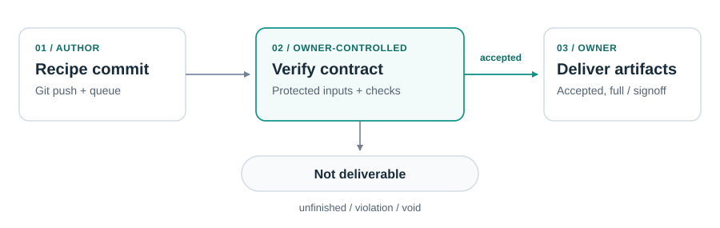

<p align="center">
  
</p>

<h1 align="center">GuardCI</h1>

<p align="center">
  <strong>Continuous verification for autonomous EDA.</strong><br>
  Push a recipe. Verify the contract. Deliver the evidence.
</p>

<p align="center">
  <a href="https://github.com/GuardCI-project/GuardCI/actions/workflows/ci.yml"></a>
  
  <a href="LICENSE"></a>
  
</p>

<p align="center">
  <a href="#why-guardci">Why GuardCI</a> &nbsp;·&nbsp;
  <a href="#quick-start">Quick start</a> &nbsp;·&nbsp;
  <a href="#real-design-verification">Real EDA</a> &nbsp;·&nbsp;
  <a href="#verdicts">Verdicts</a> &nbsp;·&nbsp;
  <a href="#documentation">Documentation</a>
</p>

---

## Why GuardCI

Autonomous agents can change implementation recipes quickly. GuardCI keeps the
acceptance decision outside the agent: protected inputs, configured checks and
commit history determine whether a result can be delivered.

| Protect the task | Verify independently | Preserve the evidence |
| :--- | :--- | :--- |
| Keep the baseline and contract under owner control. Check that changes stay within the permitted recipe. | Build and measure with the owner's configured tools, rather than accepting the agent's claims. | Track verdicts and invalid ancestry. Export eligible design artifacts with a SHA-256 manifest. |

> **A successful `git push` means queued, not accepted.**
> Only `accepted` results with `full` or `signoff` coverage are eligible for delivery.

## How it works

<p align="center">
  
</p>

The owner calls `guardci deliver` separately. It exports an eligible result;
the selected commit need not be `HEAD`.

## Quick start

**Linux · Python 3.10+ · Git 2.28+** — no EDA tools required for the static demo.

### 1. Install

```sh
git clone https://github.com/GuardCI-project/GuardCI.git
cd GuardCI
python3 -m venv .venv
. .venv/bin/activate
python -m pip install .
guardci --help
```

### 2. Try the Git + CI loop

```sh
python scripts/smoke_git_ci.py --root /absolute/path/to/new-smoke-directory
```

The demo runs a continuous worker and exercises real Git pushes: a legal recipe,
a protected-input change, an invalid descendant, clean-branch recovery and a
queued commit processed after restart. It retains evidence and stops its worker.

> **Demo boundary:** this uses a static-only contract and the null flow.
> It is not physical-design signoff.

## Real design verification

Bring a compatible validator image, an ORFS flow tree and licensed design/PDK
inputs. These are **not bundled**; start with the [validator guide](docs/VALIDATOR.md).
A development image tag is not a public installation channel.

<details>
<summary><strong>Set up the worker, push a recipe and export a result</strong></summary>

### Owner: initialize and serve

```sh
PROJECT="$PWD/my-ci-project"
guardci init "$PROJECT" --contract orfs-rebuild --flow orfs \
  --platform nangate45 --design gcd --reset-port reset \
  --from /absolute/path/to/flow --image YOUR_VALIDATOR_IMAGE \
  --slots 1 --cpus-per-slot 4 --memory 16g
guardci serve --project "$PROJECT"
```

Review CPU affinity, lock directories and resource limits for your host before
starting. Keep the worker running to process incoming commits.

### Author: commit, push and inspect

In another terminal, set `PROJECT` to the **same absolute path**:

```sh
git clone "$PROJECT/remote.git" work
cd work
# Make a permitted recipe change; use your normal Git author identity.
git add designs/nangate45/gcd/config.mk
git commit -m "Improve implementation recipe"
git push origin HEAD:main
guardci status "$(git rev-parse HEAD)" --json --project "$PROJECT"
```

Poll the exact commit until its verdict is terminal. Check both the verdict and
coverage, not just the CLI exit code.

### Owner: deliver

```sh
guardci deliver --out /absolute/path/to/new-delivery --project "$PROJECT"
```

Inspect the manifest's selected node and file hashes. Delivery does not implicitly
accept the current branch tip.

</details>

## Verdicts

| Verdict | What it means | Delivery |
| :--- | :--- | :--- |
| `accepted` | Applicable contract requirements are satisfied; warnings may remain. | Eligible with `full` / `signoff` coverage |
| `unfinished` | Exit requirements are unmet; this is not by itself an invariant violation. | No |
| `violation` | An invariant failed. | No |
| `void` | Invalid ancestry under the configured policy. | No |

`pending`, `verifying` and `unknown` are **not passes**. An internal reference-baseline
state is not sufficient evidence of delivery eligibility.

## Documentation

| Start here | Go deeper |
| :--- | :--- |
| [Operations](docs/OPERATIONS.md) — Git, workers and delivery | [Architecture](docs/DESIGN.md) — components and trust boundaries |
| [Contracts](docs/CONTRACTS.md) — policies and acceptance rules | [Validator setup](docs/VALIDATOR.md) — external EDA requirements |
| [Contributing](CONTRIBUTING.md) — development and tests | [Security](SECURITY.md) — isolation and private reporting |
| [Release checklist](RELEASE_CHECKLIST.md) — publication gates | [Provenance](THIRD_PARTY_NOTICES.md) — source and dependency notices |

<details>
<summary><strong>Development commands</strong></summary>

```sh
python -m pip install ".[dev]"
pytest -q
ruff check .
python -m build
```

Host Tcl and Icarus enable optional script and simulation regressions; report
skipped tests explicitly. Distribution checks and smoke tests are documented in
[Contributing](CONTRIBUTING.md).

</details>

## Scope and license

**Version 0.0.1 is a single-host research prototype**, not a hardened multi-tenant
Git service or a turnkey EDA distribution. It is not published on PyPI. No
experiment data, model credentials, PDKs or tool binaries are bundled.

GuardCI is licensed under [MIT](LICENSE), including the ppa-hack-bench ports
authorized by their owner. Preserve the [provenance notices](THIRD_PARTY_NOTICES.md);
external tools, PDKs and images retain their own licensing requirements.
